<p align="center">
  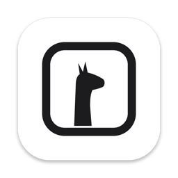
</p>

<h1 align="center">ColiUI</h1>

<p align="center">
  A native, lightweight Mac app for <a href="https://github.com/abiosoft/colima">Colima</a> and Docker.<br>
  Containers, logs, a terminal, images, volumes and networks — in a window and the menu bar.
</p>

<p align="center">
  <a href="https://github.com/Juan-Motta/coliui/releases/latest"><b>Download the latest release</b></a>
</p>

<p align="center">
  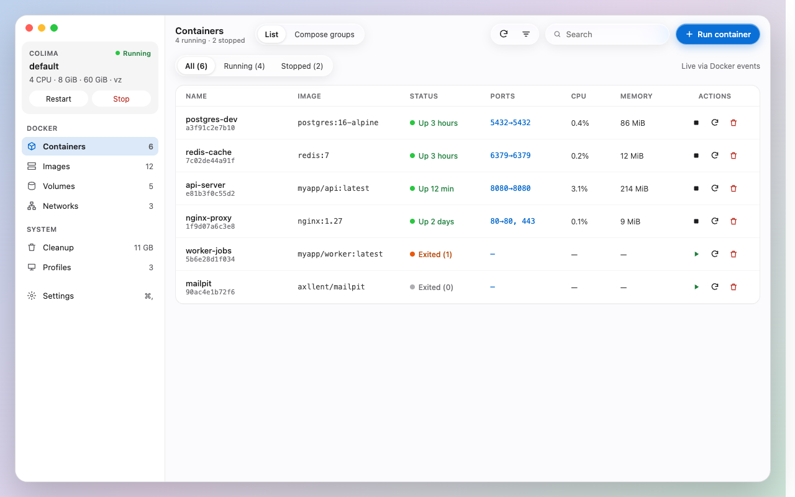
</p>

> The screenshots come from the app's design canvas, which the app follows exactly.

## Install

1. Install Colima: `brew install colima`. ColiUI uses its Docker runtime, the default.
2. Download `ColiUI-x.y.z.dmg` from the [latest release](https://github.com/Juan-Motta/coliui/releases/latest).
3. Open it and drag **ColiUI** to **Applications**.

ColiUI needs **macOS 26** or later. It's signed and notarized by Apple, and it updates itself: Settings › About › Updates, or **Check for Updates…** in the menus.

## What you can do

### Containers at a glance

Every container with its status, ports, CPU and memory, updated live from Docker events. Filter by running or stopped, search, start, stop, restart or remove, and open a published port in the browser. Compose projects can be grouped, with start all and stop all.

### Logs

Live logs that open at the newest line. Filter by text or regex, follow, show timestamps, pick a time range, and export what you see.

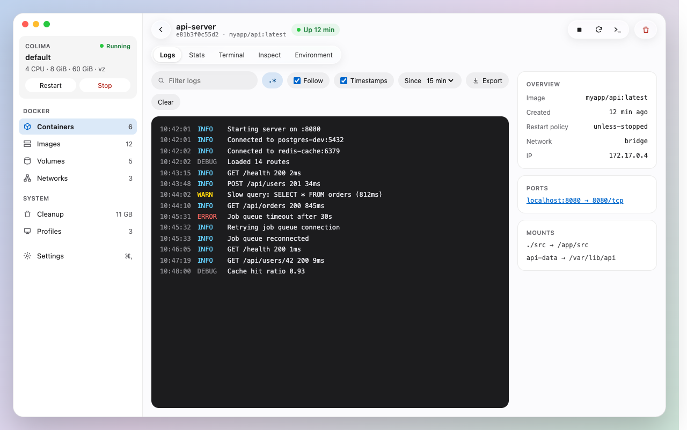

### Terminal

A shell inside the container, right in the app.

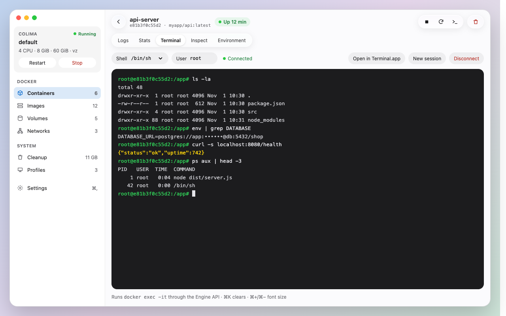

### Everything else about a container

| | |
| --- | --- |
| **Stats** — live CPU, memory, network and block I/O charts | **Files** — browse folders, preview files and download them |
| 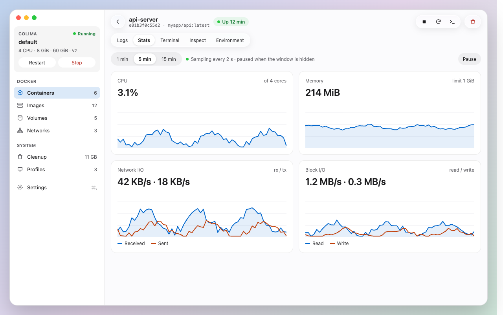 | 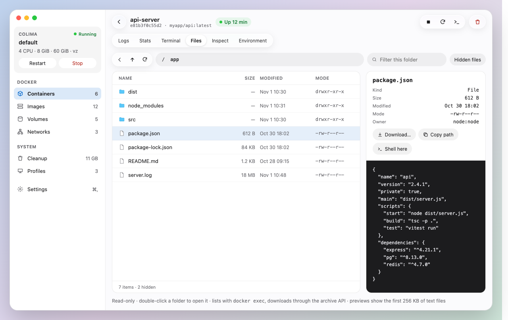 |
| **Environment** — variables from the image and the container, secrets masked | **Inspect** — the full `docker inspect` as a collapsible tree |
| 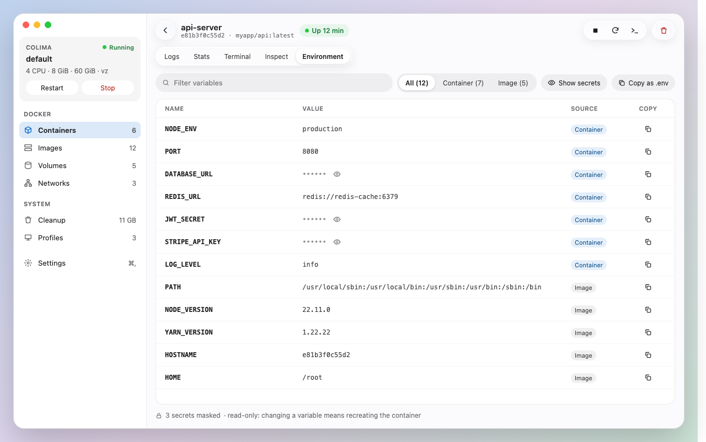 | 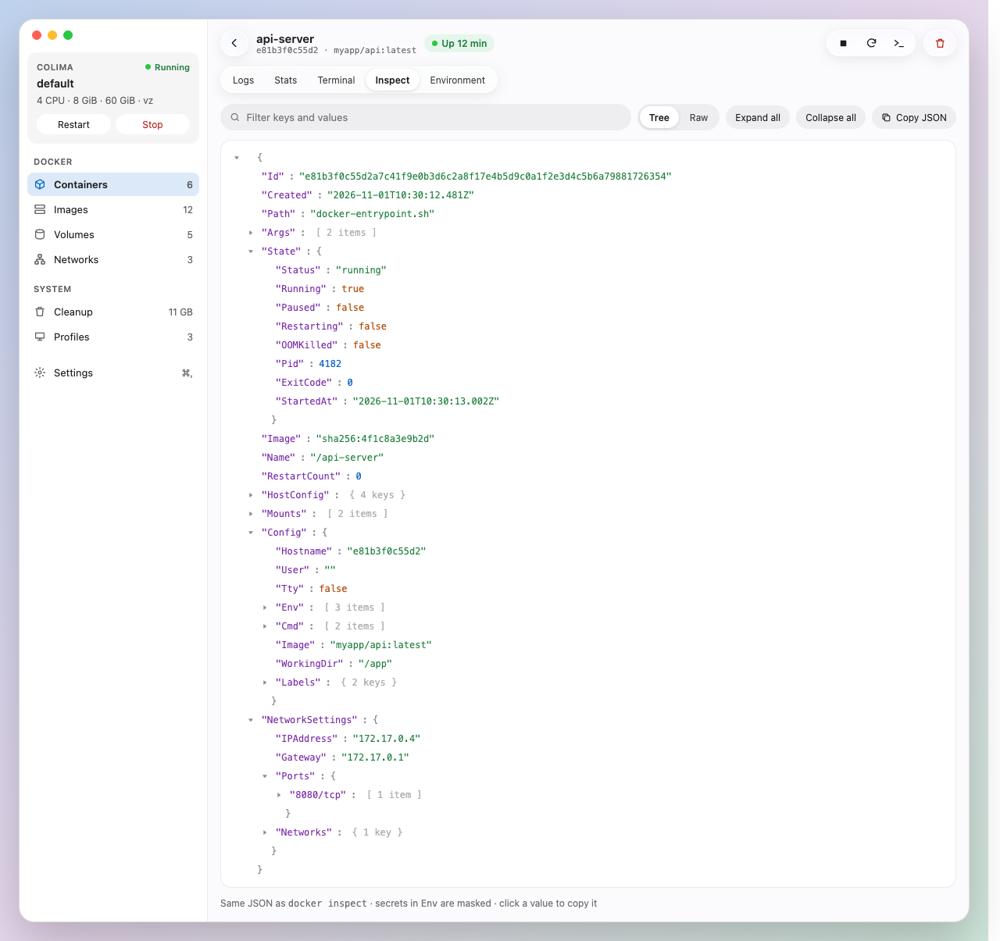 |

### Run, clean up and manage Colima

| | |
| --- | --- |
| **Run a container** — image, name, ports, volumes, environment and restart policy | **Cleanup** — see what fills the VM disk and prune it |
| 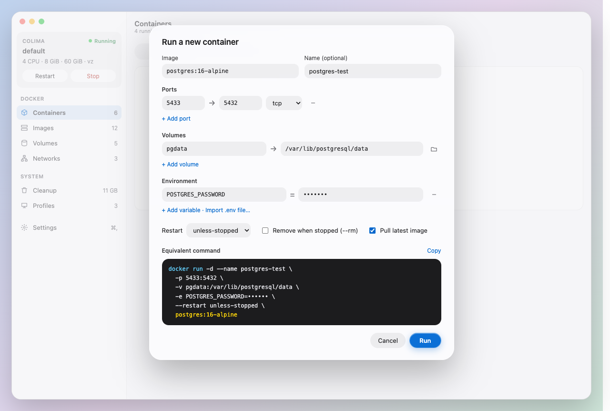 | 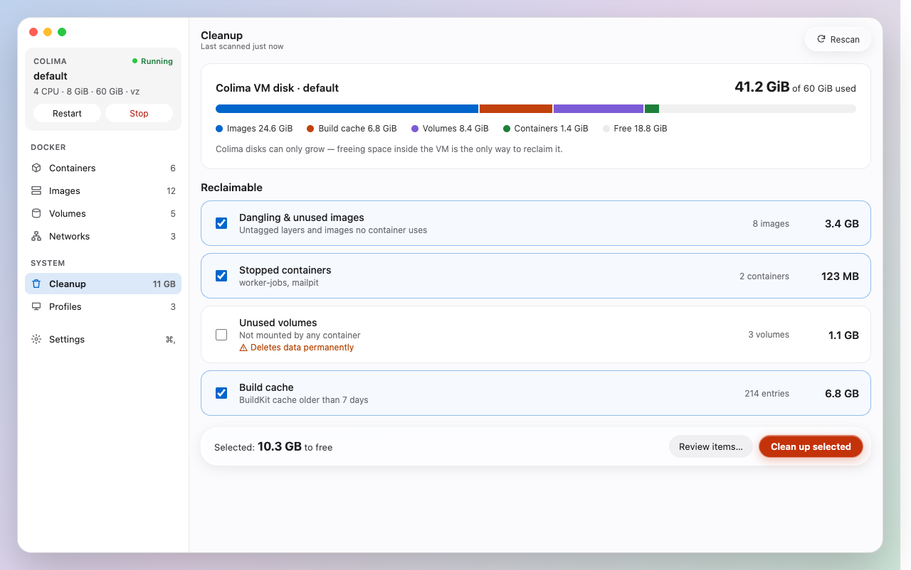 |
| **Profiles** — create, edit and delete Colima profiles | **Menu bar** — VM status and quick start and stop, without opening the window |
| 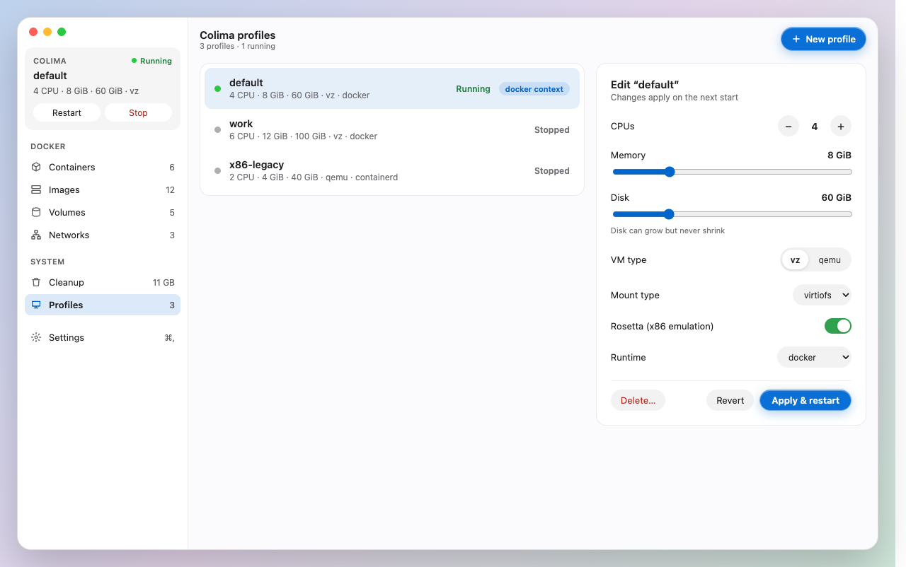 | 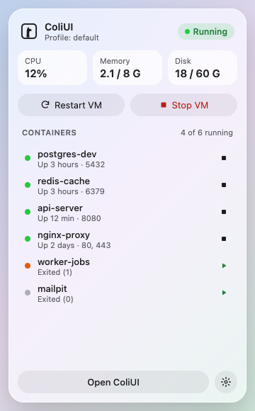 |

Images, volumes and networks have their own screens too, and Settings covers startup, notifications (a container that crashes or restart-loops, a VM that stops, a disk almost full), shortcuts and a light or dark theme.

## Build from source

You need Swift 6.2 or later; the Command Line Tools are enough, Xcode is optional.

```bash
swift run ColiUI          # run from source
swift test                # run the test suite
scripts/bundle.sh         # build build/ColiUI.app
open build/ColiUI.app
```

```bash
COLIUI_LIVE=1 swift test  # also runs the read-only tests against your real Colima socket
```

`swift test --filter …` fails with the Command Line Tools (the Testing macro plugin isn't loaded); run the whole suite instead.

Releases, signing and updates: [docs/RELEASING.md](docs/RELEASING.md). Designs: [design/](design/README.md).

## How it works

ColiUI talks to the Docker Engine API directly over Colima's Unix socket (`~/.colima/<profile>/docker.sock`, or a `unix://` `DOCKER_HOST`), and to the `colima` CLI for the VM. No Docker CLI or Docker Desktop is needed.

```
Sources/
  ColiUICore/            no third-party dependencies
    Domain/              containers, images, logs, stats, profiles, release notes
    Ports/               what the app needs: repositories, streams, the Colima runtime
    Adapters/Docker/     HTTP/1.1 over the Unix socket → Docker Engine API
    Adapters/Colima/     the `colima` CLI
  ColiUI/                SwiftUI app: composition root, view models, views
```

> On the macOS 27 SDK, SwiftUI's `@State` is a macro whose plugin ships only with Xcode. To keep the project buildable with the Command Line Tools, UI state lives in `@Observable` models instead of `@State`.
