# ColiUI design system

How ColiUI looks, and the code that draws it. Every value here comes from [`Sources/ColiUI/Shared/DesignSystem.swift`](../Sources/ColiUI/Shared/DesignSystem.swift); build new screens from these pieces instead of new colours, fonts or button styles.

## Quick rules

1. **Colours come from `Palette`.** Never `.red`, `.blue`, `.black.opacity(…)` or a hex in a view: each token has a light and a dark value.
2. **Text uses `.ui(size, weight)`** (SF Pro) **or `.mono(size, weight)`** (SF Mono) at the sizes below.
3. **Buttons use the shared styles:** `TintButtonStyle` for the main action, `PillButtonStyle` for the rest, `ToolbarIconButtonStyle` for icons.
4. **Surfaces use the shared modifiers:** `.cardSurface()` for content, `.glassSurface(_:)` / `GlassCapsule` for toolbars, `.modalSurface()` for dialogs.
5. **Icons come from `LineIcon`** (stroked, 24-unit grid), or SF Symbols where no `LineIcon` exists.
6. **Light and dark both work** — check both (System Settings › Appearance) before opening a pull request.

## Look and feel

Liquid Glass on macOS 26: a soft window (`Palette.window`), a translucent sidebar, white cards with a hairline border for content, and glass capsules for toolbars. Blue (`Palette.tint`) marks the one main action on a screen; green, orange and grey mark state (running, exited with an error, stopped).

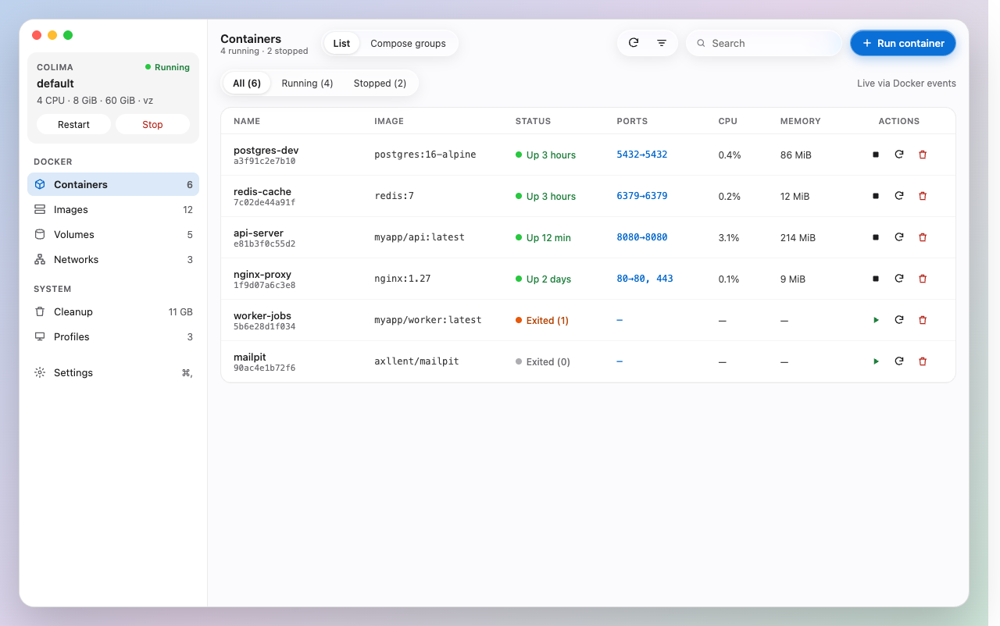

## Colours

Each swatch shows the light value on the light window and the dark value on the dark window.

<!-- COLOURS:BEGIN (scripts/make-design-swatches.py) -->
| | Token | Light / dark | Notes |
| --- | --- | --- | --- |
| 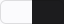 | `Palette.window` | `#FBFBFD` / `#1C1C1E` |  |
| 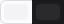 | `Palette.sidebar` | `rgba(240, 240, 244, 0.72)` / `rgba(48, 48, 52, 0.72)` |  |
| 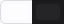 | `Palette.glass` | `rgba(255, 255, 255, 0.6)` / `rgba(44, 44, 48, 0.6)` |  |
| 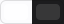 | `Palette.glassBorder` | `rgba(255, 255, 255, 0.8)` / `rgba(255, 255, 255, 0.12)` |  |
| 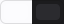 | `Palette.modalSurface` | `rgba(252, 252, 254, 0.94)` / `rgba(44, 44, 48, 0.94)` | Modals: the dialog card and the wash over the window behind it. |
| 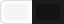 | `Palette.modalBackdrop` | `rgba(240, 240, 244, 0.55)` / `rgba(0, 0, 0, 0.35)` |  |
|  | `Palette.glassHighlight` | `rgba(255, 255, 255, 0.7)` / `rgba(255, 255, 255, 0.08)` |  |
| 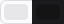 | `Palette.glassShadow` | `rgba(0, 0, 0, 0.08)` / `rgba(0, 0, 0, 0.3)` |  |
| 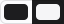 | `Palette.text` | `#1D1D1F` / `#F5F5F7` |  |
| 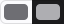 | `Palette.secondary` | `#6E6E73` / `#AEAEB2` |  |
| 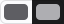 | `Palette.sidebarSecondary` | `#5E5E63` / `#AEAEB2` |  |
|  | `Palette.tertiary` | `#3A3A3C` / `#D1D1D6` |  |
| 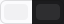 | `Palette.colimaCard` | `rgba(0, 0, 0, 0.04)` / `rgba(255, 255, 255, 0.08)` |  |
| 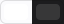 | `Palette.colimaButton` | `#FFFFFF` / `rgba(255, 255, 255, 0.12)` |  |
| 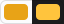 | `Palette.favorite` | `#E8A317` / `#FFC43D` | Star. |
| 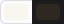 | `Palette.favoriteWash` | `rgba(232, 163, 23, 0.06)` / `rgba(255, 196, 61, 0.08)` |  |
| 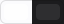 | `Palette.menuCard` | `rgba(255, 255, 255, 0.7)` / `rgba(255, 255, 255, 0.08)` | Cards on the popover glass: white at 70 %. |
| 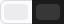 | `Palette.chip` | `rgba(0, 0, 0, 0.06)` / `rgba(255, 255, 255, 0.12)` |  |
|  | `Palette.selected` | `rgba(0, 102, 204, 0.14)` / `rgba(77, 163, 255, 0.24)` |  |
| 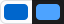 | `Palette.accent` | `#0066CC` / `#4DA3FF` |  |
| 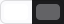 | `Palette.segmentOn` | `#FFFFFF` / `#636366` |  |
| 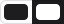 | `Palette.segmentOnText` | `#1D1D1F` / `#FFFFFF` |  |
| 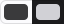 | `Palette.segmentOffText` | `#3A3A3C` / `#D1D1D6` |  |
| 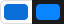 | `Palette.tint` | `#0A6FD6` / `#0A84FF` |  |
|  | `Palette.tintHover` | `#0862BF` / `#0077ED` |  |
| 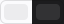 | `Palette.hover` | `rgba(0, 0, 0, 0.06)` / `rgba(255, 255, 255, 0.1)` | `.ib:hover` / `.nav:hover` washes. |
| 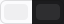 | `Palette.hoverSubtle` | `rgba(0, 0, 0, 0.05)` / `rgba(255, 255, 255, 0.08)` |  |
| 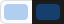 | `Palette.tintShadow` | `rgba(0, 102, 204, 0.3)` / `rgba(10, 132, 255, 0.35)` |  |
| 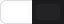 | `Palette.card` | `#FFFFFF` / `#232326` |  |
| 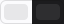 | `Palette.cardBorder` | `rgba(0, 0, 0, 0.08)` / `rgba(255, 255, 255, 0.08)` |  |
| 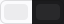 | `Palette.headerDivider` | `rgba(0, 0, 0, 0.06)` / `rgba(255, 255, 255, 0.06)` |  |
| 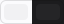 | `Palette.rowDivider` | `rgba(0, 0, 0, 0.04)` / `rgba(255, 255, 255, 0.04)` |  |
| 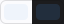 | `Palette.rowHover` | `rgba(0, 102, 204, 0.05)` / `rgba(77, 163, 255, 0.14)` |  |
|  | `Palette.field` | `rgba(0, 0, 0, 0.05)` / `rgba(255, 255, 255, 0.08)` | `.pill` / logs filter field fill and its hover. |
| 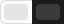 | `Palette.fieldHover` | `rgba(0, 0, 0, 0.09)` / `rgba(255, 255, 255, 0.14)` |  |
|  | `Palette.settingsBackground` | `#F5F5F7` / `#1C1C1E` | Window ground and switch tint. |
| 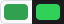 | `Palette.switchOn` | `#30A14E` / `#30D158` |  |
| 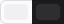 | `Palette.chartGrid` | `#F0F0F3` / `rgba(255, 255, 255, 0.08)` | Live stats gridlines (`#F0F0F3`). |
| 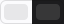 | `Palette.progressTrack` | `rgba(0, 0, 0, 0.08)` / `rgba(255, 255, 255, 0.12)` | Images pull bar: `rgba(0,0,0,0.08)` progress track. |
| 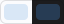 | `Palette.toggleOn` | `rgba(0, 102, 204, 0.14)` / `rgba(77, 163, 255, 0.24)` |  |
| 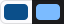 | `Palette.toggleOnText` | `#0B4F8A` / `#7BBBFF` |  |
| 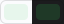 | `Palette.greenPill` | `#E7F6EC` / `rgba(48, 209, 88, 0.16)` |  |
| 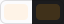 | `Palette.orangePill` | `#FEF3E7` / `rgba(255, 159, 10, 0.16)` |  |
| 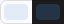 | `Palette.rowSelected` | `rgba(0, 102, 204, 0.1)` / `rgba(77, 163, 255, 0.18)` | Selected row in a card list (profiles). |
| 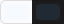 | `Palette.optionSelected` | `#F6F9FE` / `rgba(77, 163, 255, 0.1)` | Cleanup option cards when selected. |
| 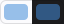 | `Palette.optionSelectedBorder` | `rgba(0, 102, 204, 0.4)` / `rgba(77, 163, 255, 0.45)` |  |
| 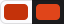 | `Palette.destructive` | `#C4320A` / `#E0451A` |  |
|  | `Palette.diskImages` | `#0066CC` | Disk bar segments: images, build cache, volumes, containers. |
| 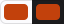 | `Palette.diskCache` | `#C2410C` |  |
| 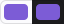 | `Palette.diskVolumes` | `#7C5CD6` |  |
| 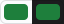 | `Palette.diskContainers` | `#1E7F3C` |  |
|  | `Palette.logBackground` | `#1C1C1E` | Log panel (same in light and dark). |
| 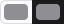 | `Palette.logTime` | `#8E8E93` |  |
| 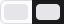 | `Palette.logText` | `#E5E5EA` |  |
| 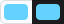 | `Palette.logInfo` | `#64D2FF` |  |
|  | `Palette.logWarn` | `#FFD60A` |  |
| 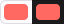 | `Palette.logError` | `#FF6961` |  |
| 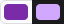 | `Palette.jsonKey` | `#7A2CA8` / `#D0A8FF` | JSON tree: keys, value types, brackets and collapsed summaries. |
|  | `Palette.jsonString` | `#1E7F3C` / `#4CD964` |  |
|  | `Palette.jsonNumber` | `#0B63C4` / `#64B5FF` |  |
|  | `Palette.jsonBool` | `#B4500F` / `#FFB340` |  |
|  | `Palette.jsonPunctuation` | `#8E8E93` |  |
|  | `Palette.jsonSummary` | `#AEAEB2` / `#6E6E73` |  |
|  | `Palette.jsonRowHover` | `rgba(0, 0, 0, 0.04)` / `rgba(255, 255, 255, 0.06)` |  |
|  | `Palette.greenText` | `#1E7F3C` / `#4CD964` |  |
|  | `Palette.greenDot` | `#28C840` / `#30D158` |  |
|  | `Palette.orangeText` | `#B54708` / `#FFB340` |  |
|  | `Palette.orangeDot` | `#E8590C` / `#FF9F0A` |  |
|  | `Palette.grayDot` | `#AEAEB2` / `#8E8E93` |  |
|  | `Palette.danger` | `#B42318` / `#FF6961` |  |
<!-- COLOURS:END -->

After changing `Palette`, run `python3 scripts/make-design-swatches.py` to refresh this table.

### What to use when

| Need | Token |
| --- | --- |
| Body text / secondary text / labels on cards | `text` / `secondary` / `tertiary` |
| The screen's main action (Run container, Pull, Install update) | `tint` via `TintButtonStyle` |
| Links, selected icons, accents | `accent` |
| Running · exited with an error · stopped | `greenDot` / `greenText` · `orangeDot` / `orangeText` · `grayDot` |
| Status pills behind those texts | `greenPill` · `orangePill` · `field` |
| Destructive actions (Remove, Stop VM) | `destructive`; error messages: `danger` |
| Card / card border / row dividers | `card` / `cardBorder` / `rowDivider` |
| Hover on a row / on an icon button | `rowHover` / `hover` |
| Fields and pill buttons (and their hover) | `field` (`fieldHover`) |
| Modal card / the wash behind it | `modalSurface` / `modalBackdrop` |

## Typography

SF Pro through `.ui(size, weight)`; IDs, images, ports, paths and logs in `.mono(size, weight)`.

| Size | Weight | Used for |
| --- | --- | --- |
| 20 | semibold | App name in About |
| 17 | semibold | Modal titles |
| 15 | semibold | Screen titles (Containers, Images…), large values |
| 14 | semibold | Card and group titles |
| 13 | regular / medium | Body text, rows, buttons in toolbars |
| 12 | regular / semibold | Secondary text, pill buttons, status pills |
| 11 | regular / semibold | Captions, uppercase section labels (`tracking 0.44`), hints |
| 12 / 11 mono | regular | Image names, IDs, ports, paths |

## Shape and spacing

| Element | Size |
| --- | --- |
| Card corner radius | 14 (`.cardSurface()`) |
| Modal corner radius | 26 (`.modalSurface()`), padding 24 × 26, width 460–520 |
| Small cards (menu bar, Colima card) | 12–14 |
| Toolbar capsule (`GlassCapsule`) | 34 tall, 3 inner padding |
| Main action (`TintButtonStyle`) | 34 tall capsule; `compact`: 28 |
| Pill button (`PillButtonStyle`) | 30 tall capsule, 12 pt text |
| Icon button (`ToolbarIconButtonStyle`) | 34 × 28, radius 14 |
| Table rows | 48–52 (containers, images, networks); menu bar rows 36; group headers 32 |
| Screen padding | 16 at the sides; 14–16 between cards |

## Components

| Component | Code | Where it shows |
| --- | --- | --- |
| Card | `.cardSurface(radius:)` | Every list and panel |
| Glass toolbar capsule | `GlassCapsule { … }`, `.glassSurface(_:)` | Toolbar groups, search |
| Segmented control | `CapsuleSegmented(options:selection:style:)` (`.glass` in toolbars, `.field` in forms) | List / Compose groups, filters, Settings choices |
| Main / secondary / icon buttons | `TintButtonStyle`, `PillButtonStyle`, `ToolbarIconButtonStyle` | Everywhere |
| Row hover and selection | `.rowWash(isSelected:)` with `Hoverable` | Tables |
| Status | `StatusBadge`, `Container.statusTint` / `statusTextColor` | Rows, sidebar, menu bar |
| Modal | `ModalPanel`, `ModalTextField`, `.modalSurface()`, shown by `ModalHost` (closes on an outside click) | Run container, Pull image, New volume / network / profile, updates |
| Empty, loading and error states | `MessageCard` | Detail tabs, lists |
| Toast | `ToastView` / `Toast` | "Copied …", "Removed …" |
| Icons | `LineIcon(kind:).icon(color, size:)` — containers, images, volumes, networks, cleanup, profiles, settings, refresh, sort, search, plus, trash, chevrons, terminal, download, folder, copy, external, check, warning, minus, bell, keyboard, eye, lock, arrowUp, link, info | Sidebar, toolbars, rows |

### Hover

`Hoverable { hovered in … }` gives a view its own hover state. Don't use `@State` for it (see [CONTRIBUTING.md](../CONTRIBUTING.md)).

## Screens

<table>
  <tr>
    <td width="50%" valign="top"><b>Logs</b> </td>
    <td width="50%" valign="top"><b>Stats</b> </td>
  </tr>
  <tr>
    <td width="50%" valign="top"><b>Run container (modal)</b> </td>
    <td width="50%" valign="top"><b>Cleanup</b> </td>
  </tr>
</table>

More in the [README](../README.md#what-you-can-do).

## Proposing an interface change

1. Build it from the pieces above; if something new is needed (a colour, a component), add it to `DesignSystem.swift` with a comment, not inline in a view.
2. Attach light and dark screenshots to the pull request.
3. The maintainer keeps the design canvas in sync with what's merged.
